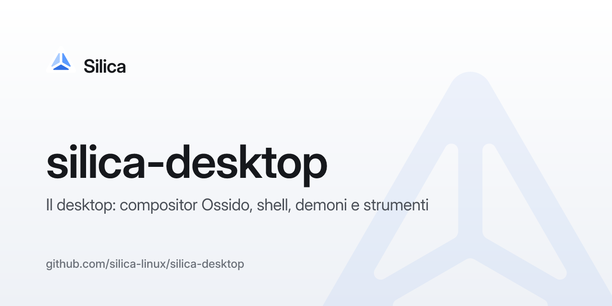

# Silica Desktop

Il desktop di Silica, scritto da zero in Rust e Flutter: un ambiente Linux con un linguaggio
visivo a vetro, misurato su osservazioni reali e reimplementato in modo indipendente
(clean-room: niente codice, testi o immagini di altri sistemi).

| Parte | Cosa fa |
| --- | --- |
| `crates/ossido` | il compositor Wayland (Smithay): finestre, decorazioni, spazi, Panorama, trascinamento fra app |
| `crates/ossido-render` | il renderer GLES: vetro, ombre, barre delle finestre |
| `crates/embedder` | l'embedder Flutter per la shell e le app |
| `crates/daemon` | i servizi di sistema su D-Bus: rete, audio, luminosità, aspetto |
| `crates/portal` | il backend di xdg-desktop-portal |
| `crates/control`, `crates/cli` | il canale di controllo, `silica-cli` e il server MCP |
| `shell/` | la shell in Flutter: barra dei menu, Dock, Faro, notifiche, Centro di controllo |

Per provarlo, annidato in un altro desktop:

```sh
cargo xtask run --nested --shell
```

Le regole di lavoro sono in [`AGENTS.md`](AGENTS.md), la documentazione in [`docs/`](docs/).
Gli altri repository (silica-ui, silica-icons, Mustache, la distro) sono elencati in `AGENTS.md`.
