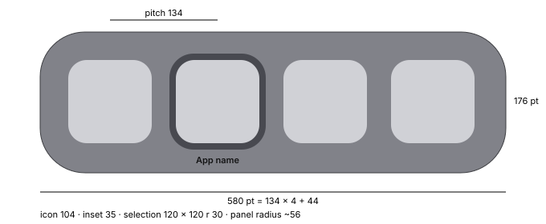

# App switcher (⌘Tab)

Measured on macOS 27 (1 pt = 1 px, 2560 × 1440, neutral gray background). Reference: the app
switcher notes and PA-40, PA-41 in silica-reference.

## Panel (ref: appswitcher › panel; PA-40)

| Property | Value |
|---|---|
| Position | centred on the screen (horizontally and vertically) |
| Height | 176 pt with the full-size row (row pitch + 42) |
| Width | `pitch × n + 44` pt (4 apps: 580, 8 apps: 1116, 15 apps: 2054) |
| Corner radius | ~56 pt (not a full capsule) |
| Material | the Dock material: light fill `#818289`, dark `#68696e`; bright top and bottom line `#bdbec8` with a 7 pt inner gradient towards the fill; dark side border `#3c3d41`; translucent (windows behind show through) |
| Shadow | practically none (a barely visible halo below) |
| Overflow | when the row would exceed the screen minus 33 pt per side (over ~18 apps), icons and pitch shrink together; 25 apps: pitch 98, icons 76, panel 140 pt tall, selection box ~87 |
| Rows | always one |

## Icons and selection (ref: appswitcher › icons, selection)

| Property | Value |
|---|---|
| Icon size | ~104 pt |
| Pitch | 134 pt (~30 pt between icons) |
| Inset from the panel edge | 35 pt left and top |
| Selection box | rounded square around the icon, icon + 8 pt per side (120 × 120), radius ~30 pt |
| Selection colour | light `#484950`, dark `#a9aaaf` (the Dock separator colours) |
| App name | under the selection box, 7 pt below, centred; semibold, ~14 pt; light `#131314`, dark `#f7f7f8` |
| Light / dark | icons are identical in both |

## Behaviour (ref: PA-40, PA-41)

- **Order**: most recently used first. ⌘Tab starts with the second app selected.
- **Appearing**: the panel shows up ~150–180 ms after Tab, in one frame (no fade, no scale). A
  quick ⌘Tab released before that never shows the panel and just switches to the previous app.
- **Selection**: jumps in the same frame as the key. Tab and → go forward, ⇧Tab and ← go back.
  Moving the pointer over an icon selects it immediately.
- **Releasing ⌘**: switches to the selected app; the panel fades out in ~190 ms (roughly linear).
- **Esc**: closes the panel in the next frame with no animation; the app does not change.
- **Q** while open: quits the selected app; its icon goes away, the panel shrinks by one pitch and
  recentres, and the selection moves to the icon that slides into its place.
- **H** while open: hides the selected app; the switcher stays open and the icon shows no change.
- **↓** while open: opens App Windows for the selected app (see [panorama.md](panorama.md)); it
  stays after ⌘ is released and closes with Esc.
- An app continued from a phone appears in a separate box of the same material to the left of the
  panel, with a phone badge on its icon.

## Not measured

- ⌘\` and ↑ inside the switcher; dropping a file on an icon.
