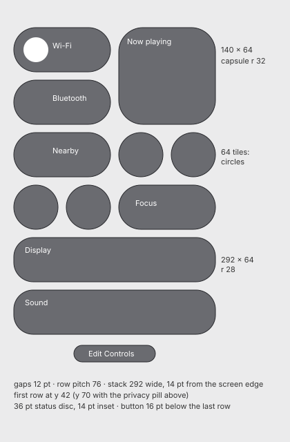

# Control Center

The panel opened from its icon in the menu bar. Measured on the grey wallpaper; on that
background light and dark are pixel-identical, except for the active Dark Mode tile. The
blur, colour and lens of the modules are in
[glass.md](glass.md#control-center-modules-glassmd--control-center).

## Layout (CC-00, SH-CC-01)

There is **no background panel**: the Control Center is a stack of separate glass modules,
anchored to the right of the screen.

Positions with the privacy pill showing:

| Module | x | y | Size |
|---|---|---|---|
| Wi-Fi | 2254 | 70 | 140 × 64 |
| Bluetooth | 2254 | 146 | 140 × 64 |
| Now playing | 2406 | 70 | 140 × 140 |
| Nearby sharing | 2254 | 222 | 140 × 64 |
| Window grouping (small tile) | 2406 | 222 | 64 × 64 |
| Screen mirroring | 2482 | 222 | 64 × 64 |
| Dark Mode | 2254 | 298 | 64 × 64 |
| Screen capture | 2330 | 298 | 64 × 64 |
| Focus | 2406 | 298 | 140 × 64 |
| Display | 2254 | 374 | 292 × 64 |
| Sound | 2254 | 450 | 292 × 64 |
| Edit Controls button | 2341 | 530 | 118 × 24 |

- **Grid:** two columns of 140 pt with **12 pt** gaps in both directions, so the row pitch is
  76 pt. Two 64 pt tiles fit in one 140 pt column.
- **Stack width:** 292 pt, ending **14 pt** from the screen's right edge.
- **Top:** without the privacy pill the first row is at y 42. With the pill the whole stack
  moves down **28 pt**.
- **Privacy pill:** 24 pt tall, starting at y 40, with 6 pt between it and the first module.
- **Edit Controls button:** 16 pt below the last module, more than the 12 pt between modules.
- **Border overhang:** the 1 pt border extends 1 pt beyond each module's frame on the left.

## Module shapes

| Module | Shape | Radius |
|---|---|---|
| 64 × 64 tiles | **true circle**, 64 pt across | 32 |
| 140 × 64 modules | **capsule** | 32 |
| Display and Sound (292 × 64) | rounded rectangle, **not** a capsule | **28** (27–28) |
| Now playing (140 × 140) | rounded rectangle | about 35 (±1) |
| Edit Controls button, privacy pill | capsule | 12 |

## Border and fill

The edges are like the Dock's: **bright at the top and bottom, dark at the sides**, 1 pt.

| Element (light, over grey) | Value |
|---|---|
| Top edge | `#bfc0c7` (large module up to `#c6c7cc`) |
| Gradient below the top edge (about 4–5 pt) | `#7d7e84 → #74757b → #707076 → #6c6d72 → #6a6b70` |
| Bottom edge | `#babcc5` |
| Gradient above the bottom edge (5 pt) | `#6b6c71 #6d6e74 #707076 #737479 #7b7c81` |
| Side edges | `#26272b`–`#27282c`, almost black |
| Fill over `#7a7b80` | `#6a6b70` |
| Top edge of Display and Sound | about `#c7c8cc` |

- **Fill:** about 16 levels darker than the grey behind it, the same tone as the shaded
  wallpaper around the stack. Modules stand out mostly by their edges and content.
- **Light and dark:** the material does not change between them.

### Shadow

The stack casts a **wide, soft shadow** over the wallpaper:

| Distance left of the stack (pt) | 0 | 14 | 34 | 54 | 74 | 94 | 114 | 134 |
|---|---|---|---|---|---|---|---|---|
| Darkening (levels, out of 122) | −10 | −9 | −8 | −5 | −3 | −2 | −1 | 0 |

- **Right side:** a constant −12 down to the screen edge.
- **Above and below:** −11 above the pill; below the stack −10, falling to −3 within about
  40 pt.
- **Not per module:** the shadow is uniform along the stack and cannot be split per module.
  Treat it as one shadow under the whole stack (*provisional*).

## Toggles

| Element | Value |
|---|---|
| Icon disc in a 140 × 64 module | **36 pt**, 14 pt from the left and from the top and bottom |
| Active disc | white `#ffffff`, glyph `#007aff` |
| Inactive disc | `#8f9094`, glyph white |
| Disc to text | 7 pt |
| Inactive 64 pt tile | no disc: a white glyph of about 20 pt in the centre |
| **Active** 64 pt tile | the **whole tile turns white**, with a black glyph; the border stays |
| Output button in Sound | a 26 pt circle `#8f9094` with a white glyph |
| Artwork in Now playing | 40 × 40, radius about 8–10 |

- **Glyph colour:** the active glyph is the same blue on every module.

### Text

Sizes are inferred from the cap height, assuming Inter (0.727).

| Text | Size | Weight | Colour |
|---|---|---|---|
| Module title | 12–13 pt | semibold | white |
| Module subtitle | 11 pt | regular | white |
| Display and Sound titles | 12–13 pt | semibold | white |
| Edit Controls, privacy pill | 12–13 pt | semibold | white |
| Detail panel header | 14 pt | semibold | white |
| Detail panel rows | 14 pt | regular | `#f0f0f1` |
| Section headers in details | 12–13 pt | bold | white at about 50–55 % (`#b7b8be` over the fill) |
| Labels under detail tiles | 11–12 pt | bold | white |
| Subtitles under detail tiles | 11 pt | regular | white about 50 % |

- **Module with three lines** (title and two subtitle lines): the text starts at +56 pt from
  the module's left edge, and the lines are 14 pt apart. The block is centred vertically.
- **Display and Sound:** the title is 16 pt from the left edge, with its cap top 13 pt from
  the top.
- **Wrapping:** long subtitles wrap onto two lines, for example the network name, or the
  "not playing" text in the narrow Now playing module.

## Sliders

**In the Control Center:**

- **Track:** **4 pt**, rounded ends.
- **Fill:** white, ending at x₀ + 10 + v · (L − 20), as if an invisible 20 pt knob sat at the
  end. The rest of the track is `#7e7f84`.
- **Knob:** none visible.
- **Brightness without hardware control:** the track shows `#88898e` with no fill. This
  happened with external monitors that have no brightness control.
- **End icons:** a small icon at the left end and a larger one at the right end, both
  white, for example a small and a large speaker.

**In a detail panel:**

- **Track:** **6 pt**. The fill is white, and the rest is `#7a7b80` over a `#68696e` fill.
- **Knob:** **20 × 16** capsule, `#e8e9ea`, centred at x₀ + 10 + v · (L − 20).
  - Its rim is a slightly brighter glass ring.
  - It casts a small shadow onto the track on its right.

## Edit Controls button and the menu bar icon

- **Edit Controls button:** a 118 × 24 capsule.
  - Its edges are fainter than the modules' at the top and bottom, `#9b9da2`, and the sides
    are `#2d2d31`.
  - The fill is the modules' fill.
  - The text is white, about 11–12 pt from each side.
- **Menu bar icon while the Control Center is open:** it gets a highlight capsule of
  **46 × 24**, centred on the icon, 10 pt wider than the icon on each side.
  - It barely lightens the bar, by +3 levels, with no border.
  - The bar around it is already darkened by the stack's shadow.

## Privacy pill

- **Shape:** a capsule 24 pt tall, 161 pt wide for a medium-length app name. Its edges are
  the modules' edges.
- **Fill:** `#65666c`.
- **Icon:** a 15 pt rounded square, `#6e7cff`, with a white glyph, 11 pt from the left.
- **Text:** the app or service that used a resource recently, bold, `#f0f0f1`, starting
  21 pt after the icon.

## Detail panels (CC-00, SH-CC-14…19)

Opening a module's detail turns that module into **one panel**, and the rest of the grid
fades.

| | Wi-Fi | Display | Sound |
|---|---|---|---|
| Height | 258 | 242 | 226 |

- **Width:** **308 pt** for every panel.
  - It extends 10 pt left and 6 pt right of the stack, so its right edge is 8 pt from the
    screen's edge.
  - Its top edge is at y 36, 6 pt above where the first module sits without the pill.
- **Corner radius:** **16 pt**.
- **Edges and fill:**
  - The edges are like the modules': bright `#c7c8cf` at the top and bottom, with a gradient
    of about 4 pt, and dark sides.
  - The fill is `#6a6b70`.
  - The shadow is weaker than the stack's.
- **Margins:** 14 pt on each side.
- **Separators:** 1 pt `#7e7f84`, 280 pt long. Some are full width, 298 pt.
- **Rows:** 32 pt tall and 280 pt wide.
  - Each has a **26 pt** icon circle: inactive `#8f9095`, active white with a blue glyph.
  - The text starts 12 pt after the circle.
- **Section headers:** bold, white at about 50 %.
  - There are about 9.5 pt from a separator to the header, 18.5 pt from the header to the
    first row, and 5 pt from the last row to the separator.
- **Secondary glyphs:** signal bars, network type, lock and the expand arrow are
  `#b7b8bd`.
- **Header:** the panel's title, at (14, 13) from the panel's corner, with a **54 × 24**
  master switch on the right for Wi-Fi, Bluetooth and nearby sharing.
  - The switch is on in **`#0074f8`**, slightly darker than the glyph blue.
  - The knob is a white **32 × 20** capsule, with 2 pt margins.
- **Wi-Fi:**
  1. a privacy notice row with a warning glyph;
  2. a hotspots section;
  3. a known-network section;
  4. a collapsed "other networks" row (280 × 22);
  5. the Wi-Fi settings item.
- **Bluetooth:** one row per paired device. A connected device has a filled blue icon.
  - The Bluetooth settings item comes last.
- **Nearby sharing:** two rows, "contacts only" (selected) and "everyone". No list of
  devices.
- **Focus:** one row per Focus mode.
  - Turning one on fills its icon purple and adds the subtitle "Focus on".
  - Two 22 pt options, "for one hour" and "until this evening", appear under it on a
    tinted band.
  - The same panel is the menu of the Focus status item.
- **Display:**
  - one slider per display, each under its own header;
  - then two tiles of **40 pt** circles (`#8f9094`), Dark Mode and night light, each with
    its label and subtitle centred below;
  - a separator, then the display settings item.
- **Sound:**
  - the volume slider;
  - an "output" section with one row per device;
  - the sound settings item.

## Now playing (CC-04)

- **The 140 × 140 module, from top to bottom:**
  - **Artwork:** a 40 × 40 cover with radius about 8 and a light shadow, or the app icon in
    a grey 40 × 40 box.
  - **Text:**
    - with metadata, two lines: the title in white semibold, and "artist – album" in
      `#b7b8bd`, each truncated to one line;
    - with no metadata, one line with the app's name.
  - **Three 30 × 30 buttons** at a 40 pt pitch: previous, play/pause, next, or −15 s / +15 s
    when the app offers skipping. Disabled buttons are `#9d9ea3`, active ones `#b7b8bd`.
- **Button states:**
  - **Hover** lightens the whole module by about 7 levels, and the glyph under the pointer
    to `#bebfc4`.
  - **Pressing** turns only the glyph white (`#f7f7f8`), with no pill and no size change.
  - **Releasing** play/pause swaps the glyph between two bars and a triangle.
- **Detail:** a click on the title or artwork opens a **308 × 140** panel.
  - a **112 × 112** cover on the left;
  - the title, and "artist – album", at the top right, with an audio-output indicator;
  - three **26 × 26** buttons at a 56 pt pitch;
  - a **154 × 12** progress bar: a track of 3–4 pt, `#232323`, with the elapsed part in
    `#1482ff`;
  - below it, the elapsed and remaining times, `#b7b8be`.

  Esc goes back to the grid.
- **Long text:** the module stays 140 × 140 and truncates.

## Animations

### Opening

- **Motion:** a fade-in with a slight scale settling. The content starts about **0.75 %
  larger** and centred on the stack, shrinking back to 1.0 in about 107 ms.
- **Opacity curve:** steep start, decelerating, with a long tail and no overshoot. α of the
  modules:

| t (ms) | 0 | 13 | 27 | 53 | 67 | 80 | 107 | 120 | 133 | 160 | 173 | 187 | 213 | 227 | 240 | 267 | 280 |
|---|---|---|---|---|---|---|---|---|---|---|---|---|---|---|---|---|---|
| α | 0.09 | 0.16 | 0.25 | 0.44 | 0.53 | 0.64 | 0.74 | 0.80 | 0.84 | 0.91 | 0.92 | 0.94 | 0.97 | 0.98 | 0.98 | 0.99 | 0.99 |

- **Stagger:** upper rows reach half opacity up to about 40 ms before lower rows.
- **Edge light:** the bright edges settle a little later than the fill.
- **Menu bar highlight:** the icon's capsule appears in the first frame.

### Closing

- **Motion:** a fade-out while growing to about 1.0075.
- **What vanishes at once:** faint content disappears in the first frame: media buttons,
  artwork, dim glyphs and slider tracks. Text and white discs fade.
- **Menu bar highlight:** the icon's capsule disappears within one frame.

| t (ms) | 0 | 13 | 40 | 53 | 67 | 93 | 107 | 120 | 147 | 160 | 173 | 200 | 213 | 227 | 240 | 280 |
|---|---|---|---|---|---|---|---|---|---|---|---|---|---|---|---|---|
| α | 0.92 | 0.86 | 0.61 | 0.49 | 0.38 | 0.24 | 0.19 | 0.14 | 0.08 | 0.07 | 0.05 | 0.02 | 0.02 | 0.01 | 0.01 | 0.00 |

### Module to detail

- **Motion:** the clicked module **morphs into the panel**, as a single rectangle whose
  edges interpolate together. It is not a cross-fade. The rest of the grid fades in about
  150–200 ms.

  Progress of the Display panel's top edge:

  | t (ms) | 0 | 13 | 27 | 53 | 67 | 80 | 107 | 120 | 133 | 160 | 173 | 213 | 240 | 320 |
  |---|---|---|---|---|---|---|---|---|---|---|---|---|---|---|
  | p | 0.08 | 0.19 | 0.31 | 0.54 | 0.63 | 0.71 | 0.82 | 0.86 | 0.89 | 0.94 | 0.95 | 0.98 | 0.99 | 1.0 |

- **Curve:** slow, fast, slow, with no overshoot.
- **Duration:** about **215 ms** for Wi-Fi, **280–320 ms** for Display and **255–330 ms** for
  Sound. It grows with the distance the top edge travels (34, 338 and 414 pt), but not in
  proportion.
- **Content:** the panel's content appears inside the growing shape about 50 ms in and is
  readable by about 120 ms. Wi-Fi's last rows pop in at the end.

## Interaction (CC-01)

- **Hover a module with a detail:** a **">" arrow** appears inside it on the right, and the
  text shortens to make room.
- **Hover a 64 pt tile:** it lightens by about 9 levels.
- **Pressing and dragging out before release:** cancels the action.
- **Clicking a 140 × 64 module:**
  - on its **icon disc** toggles the setting;
  - on its **text** opens the detail.

  The exact boundary between the two zones is *provisional*.
- **Detail timing:**
  - It opens about 120 ms after the release and settles in about 375 ms.
  - **Esc from a detail goes back to the grid** and does not close the Control Center. The
    transition takes about 360–500 ms.
- **Secondary click on a module:** opens a menu with its **top-right corner on the pointer**.
  1. a grey "size" group: small / medium / large;
  2. a separator;
  3. "copy to the menu bar", or "remove from the menu bar" when the control is already
     there;
  4. a separator;
  5. "remove".
- **Keyboard:**
  - Tab shows no focus ring.
  - **→** moves to the next status menu, as between menus in the bar.

## Edit Controls (CC-04, SH-CC-27)

- **Clicking Edit Controls:** opens a **gallery** to the left and puts the stack in **edit
  mode**.
- **Gallery window:** **736 × 900** pt, centred on the screen, in light glass with a corner
  radius of about 13–16.
  - **Left column:**
    - a search field of 205 × 28 (`#d7d8db`) on a `#c8c9ce` background;
    - a list of categories in **205 × 46** rows, each with a coloured icon and a name;
    - the selected category is shown on a `#b4b5b9` capsule.
  - **Right part:** about 494 pt wide, on `#a6a8ae`.
    - a "what's new" card;
    - a suggestions grid;
    - one section per category, with 15 pt headers.

    Each control is previewed at its size: 64, 140 × 64 or 140 × 140, plus its label.
  - **Footer:** a two-line hint, and a blue **Done** button of 54 × 28.
  - **Actions:** every control can be added to the menu bar or to the Control Center.
- **Stack in edit mode:**
  - Each module gets a **20 × 20 remove badge** on its top-left corner, 2 pt outside the
    module: a dark disc `#3c3c3d` with a light minus sign `#c6c5ca`.
  - Toggles without a detail become disabled.
  - **Eight empty round slots**, 64 pt discs `#8c8d91` in two rows of four, appear below the
    stack.
  - A "+" item appears in the menu bar.
  - The screen behind is **dimmed** by about 12 levels.
- **Timing:**
  - The gallery appears from about +185 ms after the click and settles by about +345 ms.
  - The empty slots appear later, from +412 to about +530 ms.
  - **Esc** closes everything, the gallery in about **240 ms**.

## Not measured yet

- The off states of Wi-Fi, Bluetooth and nearby sharing.
- The other 64 pt tiles in their on state.
- The active Dark Mode tile in light appearance.
- Dragging, removing and resizing controls in edit mode.
- The pressed and focus states of modules.
- Detail panels in dark appearance.
- The closing animation of a detail.
- The shadow per module.
- Brightness sliders on displays that support it.
