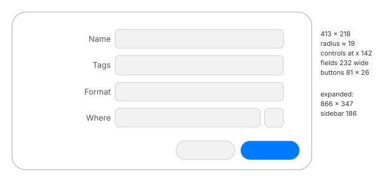

# Open and Save panels

The system panels that apps use to choose a file to open or a place to save. Silica serves
them through its file chooser portal. Measured with a document app, a new unsaved document,
and a window of 800 × 600 (MU-95, MU-96).

Alerts and context menus are specified elsewhere. The file views inside the panels are
Mustache's views, specified in the Mustache repository.

## Save panel

### Card

- **Not attached to the title bar.** It is a **rounded card**, radius about 18–20, centred
  on the window both horizontally and vertically.
- **Veil:** the window behind is veiled. White becomes `#cccccc` in light; dark becomes
  `#1a1a1a`.

| | Light | Dark |
|---|---|---|
| Card | `#ffffff` | `#272727`, with a top line of `#3d3d3d` |
| Outer border | `#a6a6a6` | `#010101` |

### Compact: 413 × 218 pt

- **Labels:** right-aligned, ending at about +136 from the card's left edge.
- **Controls:** from **x +142**, in rows:
  1. the file name: a **232 × 26** field, with the name selected;
  2. tags: a **232 × 27** token field;
  3. format: a **232 × 26** pop-up, only when the app offers formats;
  4. location: a **200 × 26** pop-up and a **26 × 26** expand button (⌄).
- **Buttons:** Cancel and Save at the bottom right, **81 × 26** each. Save is in the accent
  colour.
- **Remembered width:** after the expanded panel was resized, the compact card once reopened
  wider. Closing from the compact state brings back 413.

### Expanded: 866 × 347 pt

- **Size:** wider than an 800 pt window, so it overflows it, still centred.
- **Expanding:**
  - It starts about **190–213 ms** after the click and settles by about **420–460 ms**.
  - The card grows to the left and downwards while the sidebar slides in from the left.
- **Collapsing:** from about +105 to 358 ms.
- **Sidebar:** **186 pt**, with the same groups as Mustache's sidebar. The app's own
  documents location and shared items come first.
- **Top right:** the compact fields. Below them, a **toolbar row** holds:
  - back and forward, in a capsule of 24 × 24 segments;
  - a view pop-up, 69 × 26;
  - a group pop-up, 68 × 26;
  - the location pop-up, 232 × 26;
  - a ∧ chevron that collapses the panel;
  - a search field, 199 × 27.
- **File area:** Mustache's **icon, list and column views**, with **no gallery**.
  - At the initial size the area is only **100 pt** tall.
  - Files that cannot be chosen are **grey**.
- **Bottom:** New Folder on the left (113 × 26), and Cancel and Save on the right.
- **View menu:**
  - show sidebar;
  - show items as icons, list or columns;
  - hide extension.
- **Resizing:** the panel can be resized from its edges and stays centred horizontally.

### New folder

- **Card:** a **320 × 158** card above the panel, made of a title, a prompt naming the parent
  folder, a **282 × 26** field, and Cancel (71 × 26) and Create (55 × 26).

### Go to folder (⇧⌘G)

- **Panel:** **460 × 183**, with a **344 × 22** path field, a close button, and a list of
  recent paths in 22 pt rows.
- **Return:** takes the panel to that folder.

### Search (MU-96)

- **Suggestions:** typing in the search field shows a menu that offers to match file names or
  contents.
- **Scope bar:** a 32 pt bar appears under the toolbar row.
  - "Search in:", with two radio pills: this computer (the default) and the current folder.
    The selected pill has a grey background.
  - A "+" on the right adds criteria.
- **Results:** they are **folders only**, since a save needs a destination. They show in the
  list view.
- **Disabled while searching:** New Folder and Save.

### Appearing and closing

- **Appearing, from the key press:**
  - The **veil** starts at about +145 ms and is full by about +440 ms.
  - The card is visible from about +212 ms. It **fades in while moving down about 20 pt**,
    keeping its width, with no scaling.
  - It is still by about +480 ms.
- **Closing (Cancel):**
  - It starts about 46 ms after the release.
  - The card **fades with no movement** and is gone by about +270 ms.
  - The veil is gone by about +310 ms.
- **Dark appearance:** the same timings.

## Open panel

- **A separate window,** not a card: **880 × 448 pt**, with no visible title.
- **Layout:**
  - the 186 pt sidebar;
  - the toolbar row at the top: back and forward, view, group, location pop-up and search;
  - the file area in column view (245 pt columns, as in Mustache);
  - at the bottom left, New Document and Show Options;
  - at the bottom right, Cancel and Open. Open is disabled while nothing is selected.
- **Selection:** the chosen folder's column shows its selection in the accent colour.

## What carries over from Mustache

- **Carried over:**
  - the sidebar;
  - the icon, list and column views, with the same rows, selections and arrows;
  - the location menu;
  - ⇧⌘G;
  - grouping.
- **Missing:**
  - the gallery view;
  - tabs;
  - the path bar and the status bar;
  - full context menus.
