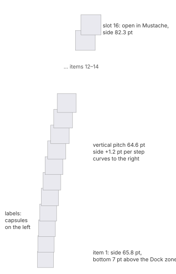

# Folder stacks in the Dock

A folder kept in the Dock, right of the separator. Clicking it shows the folder's files in
one of three views: fan, grid or list. Measured with test folders of 3, 10, 14 and 40 text
files, sorted by name, on the grey wallpaper (D-06, K-06).

## Defaults

A folder added to the Dock is sorted by **name**, displayed as a **stack**, and its content is
viewed **automatically**.

## The icon in the Dock

- **Stack:** a pile of at most three items of the folder in the stack's sort order (default
  Name; the Downloads folder: Date Added, newest first), the first in front and the others
  behind, offset upward, not rotated, with no extra shadow or darkening.
  - Each item is drawn on a **50 pt canvas** of the default 64 x 80 tile (never the full 60),
    at x = 7 and y = 17 (front), 15 and 13. Everything scales by k = canvas / 60 and rounds to
    whole points.
  - A folder inside the stack uses the same 50 pt canvas.
- **Empty folder, or Display as Folder:** the folder's own icon on the full 60 pt canvas at
  (2, 10).
- **Open stack, fan or grid:** the tile shows the silica-icons "Stack Close" badge
  (`badges.json` > `dock` > `stack-close`, light and dark) on the folder icon's canvas; the shell
  draws no cross of its own.
- **Open stack, list view:** the folder icon stays, darkened as when pressed.

## Automatic view

| Files | View |
|---|---|
| 3, 10 or 14 | fan |
| 40 | grid |

The threshold lies somewhere between 15 and 40 files. It has not been searched for
(*provisional*: Silica switches to the grid above 15, the most a fan can hold).

## Fan

- **Up to 15 files**, with the first in sort order at the bottom, next to the Dock. A 16th
  slot opens the folder in Mustache:
  - its label is "open in Mustache" when the folder has 15 files or fewer;
  - otherwise it reads "N more in Mustache", with N the files not shown.
- **Pitch:** a constant **64.6 pt** between items, vertically.
- **Size:** the icons grow by about 1.2 pt per step going up, from **65.8 to 82.3 pt**.
- **Curve:** the column curves to the **right** as it rises. The horizontal offset from the
  first item grows by these amounts, step by step:

  `+1.4, +3.3, +4.4, +6.4, +7.4, +8.4, +10.4, +12.5, +12.4, +14.5, +16.5, +17.5, +19.5, +20.6, +22.6 pt`
- **Start:** the first item's bottom edge is 7 pt above the top of the Dock zone.
- **Rotation:** icons and labels tilt clockwise more and more towards the top. The angle has
  not been measured (*provisional*).
- **Labels:** capsules to the **left** of each icon, made of the same material as the Dock's
  hover label.

  | | Light | Dark |
  |---|---|---|
  | Fill over `#7a7b80` | `#bdbec2` | `#828388` |
  | Border (1 pt) | `#424347` | `#434347` |
  | Text | `#212122` | `#f4f4f5` |
- **Hover:** no visible highlight.
- **Clicking a file:**
  1. The item darkens slightly on press.
  2. On release the stack closes at once, starting about 13 ms later and lasting about
     150 ms.
  3. Then the app opens the file.
- **Opening:**
  - It starts about **90 ms after the press** and lasts about **240 ms**.
  - The items leave the icon as a squeezed column that stretches upwards while it bends into
    the arc.
  - The labels fade in last.
- **Closing with Esc:** about **210 ms**, the same motion in reverse.

## Grid

- **Panel:** a titled panel holding a grid of **128 × 128 pt** cells. The title is the
  folder's name.
- **Columns:** ⌈√(n + 1)⌉ for n files. The extra slot opens the folder in Mustache.

  | Files | Grid | Panel |
  |---|---|---|
  | 3 | 2 columns | 290 × 310 pt |
  | 10 | 4 × 3 | 546 × 438 pt |
  | 14 | 5 × 3 | 674 × 438 pt (content 640 × 384) |
  | 40 | 7 × 6 | 930 × 822 pt (scrolling area 896 × 768) |
- **Position:** centred on the Dock icon, except where it would cross a screen edge. The tip
  points down at the icon.
- **Behaviour:**
  - Hovering a cell shows no highlight.
  - A click outside the panel closes it.
- **Opening:**
  - It starts about 70 ms after the press and lasts about **240 ms**.
  - The panel grows in scale from the icon while fading in.
- **Closing with Esc:** about **150 ms**, scaling back towards the icon while fading.

| | Light | Dark |
|---|---|---|
| Panel glass | almost white, `#f8f8f8`–`#fcfcfc` | clear dark glass, `#707176`–`#73757a` over `#7a7b80`, with a light hairline `#909197` at the top |
| Title and labels | `#252525` / `#212122` | `#f8f8f8` |
| "Open in Mustache" glyph (circle with an arrow) | dark | `#edeef2` |

## List

- **Contents:** an ordinary menu ([menubar.md](menubar.md#menus-sh-mb-0610)).
  - One row per file, each with a small icon and the file's name.
  - A separator.
  - Options ▸, the stack-settings submenu.
  - "Open in Mustache".
- **Position:** the same as the Dock menus: the frame starts 40 pt left of the icon's centre.
- **Height:** with 40 files the menu is 1055 pt tall and does not scroll.
- **Rows:** 24 pt items. The highlight is the accent blue, `#007aff` in sRGB, with white text.

| | Light | Dark |
|---|---|---|
| Fill | `#c7c8cd` | `#6f7075` |
| Text | `#1e1e1f` | `#e9e9ea` |

## Not measured yet

- Sorting by date or kind.
- Dragging a file out of a stack.
- Scrolling a full grid with the wheel.
- The list view with subfolders.
- The exact threshold between fan and grid in the automatic view.
