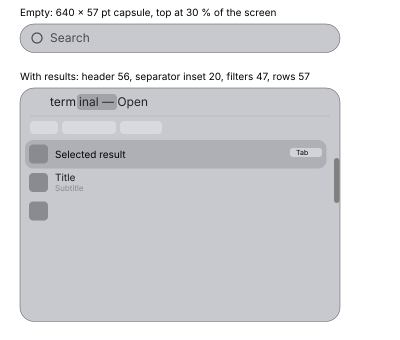

# Faro (search panel)

Faro is the system search panel (⌘Space). Measured on macOS 27 (1 pt = 1 px, 2560 × 1440,
neutral gray background). Font sizes are inferred from cap heights with Inter's proportions
(±1 pt). Saturated colours are sRGB. Reference: the search panel notes and SH-SP-04, 08, 13, 14,
17, 18 in silica-reference. The Launcher is another mode of the same panel
([launcher.md](launcher.md)).

## Panel (ref: spotlight › position; SH-SP-04)

| Property | Value |
|---|---|
| Width | 640 pt, centred horizontally |
| Top edge | fixed at 30 % of the screen height; the panel grows downwards |
| Empty (steady state) | a single capsule 640 × 57 pt: glyph, placeholder, nothing else |
| With results | 640 pt wide; header 56 pt, 1 pt separator inset 20 pt, optional filter row 47 pt, then the list; the list scrolls past ~250 pt (467 pt was the tallest panel observed) |
| Corner radius | capsule when empty (half the height); ~28.5 pt otherwise |
| Reopen | shows the previous query, selected |

First run only: a 384 pt panel with four 54 pt round buttons beside it (pitch 64, 10 pt gaps,
same material) and an introduction; after confirming it, the steady state above applies.

### Material and edges (ref: spotlight › background, material)

| | Light | Dark |
|---|---|---|
| Fill on gray | `#c8c9ce` | `#717276` |
| Top and bottom luminous row (1 pt) + inner gradient 4–5 pt | `#e1e2e7` → fill | `#9a9ba0` → fill |
| Sides | no highlight | no highlight |
| Outer dark line | ~2 pt (`#444548`–`#505154`) | 1 pt (~`#040404`) |
| Separator | `#afb0b5` | `#949599` |
| Shadow | offset ~17–20 pt down; extent ~53 below, ~18 above, ~35–45 at the sides; −38 levels just below, −23 at the sides, −8 above | about 1.7× denser (−68 below, −40 at the sides) |

The thick glass:

- Blur σ ≈ 8–14 pt with a non-Gaussian (long-tailed) kernel; no measurable sharp component.
- Transfer curve on gray is concave: highlights are compressed and blacks lifted.

| Input level | 30 | 50 | 70 | 90 | 110 | 130 | 150 | 170 | 190 | 210 | 225 |
|---|---|---|---|---|---|---|---|---|---|---|---|
| Light | 153 | 163 | 174 | 184 | 194 | 204 | 214 | 223 | 231 | 239 | 243 |
| Dark | 60 | 72 | 85 | 98 | 108 | 116 | 123 | 127 | 128 | 128 | 127 |

- Colour matrix for the chromatic tilt (levels 30–150, `out = M·in + b`, sRGB 0–255):
  light `M = [[0.801, −0.209, −0.106], [−0.066, 0.593, −0.019], [−0.146, −0.269, 0.928]]`,
  `b = [141.6, 138.7, 138.0]`; dark `M = [[1.005, −0.301, −0.085], [−0.139, 0.725, 0.025],
  [−0.164, −0.327, 1.115]]`, `b = [37.0, 39.3, 36.4]` (saturation ≈ 1.7–1.8). Use the gray table
  for brightness and the matrix only for the tilt.
- Within ~12–20 pt of the edge the glass shows content from just outside the panel (blur
  sampling past the edge or weak refraction; not separated).

## Search field (ref: spotlight › search field)

- No background or border of its own.
- Magnifier ~23 × 23 pt, 23 pt from the left edge, centred on the header; light `#494a4f`,
  dark `#edeef2`.
- Text cursor 2 × 31 pt at 61 pt from the left edge; light `#16171c`, dark `#ffffff`; fades in and
  out (see [launcher.md](launcher.md)).
- Placeholder ~26 pt regular, light `#494a4f`, dark `#edeef2`. Typed text same size, light
  `#16171c`, dark `#ffffff`.
- Inline completion of the top hit: the completed part, then " — Open" (or the fallback action,
  or "= result" for a calculation), on a neutral gray selection 32 pt tall, radius ~6–8; light
  `#a2a3a8`, dark `#97989c`; suffix text light `#232429`, dark `#ffffff`.
- Icon of the handling app at the right of the field: ~26 × 26 pt, 23 pt from the right edge.

## Result rows (ref: spotlight › result rows; SH-SP-08, 17, 18)

| Property | Value |
|---|---|
| Row | 619 × 57 pt (2 pt from the panel edge); 1 pt gap between sections |
| Selection | rounded rectangle inset 8 pt each side, full row height, radius ~16.5; light `#afb0b5`, dark `#949599`; no border |
| Unselected rows | no background, no separators |
| Icon | 38–39 pt visible (files, folders) or 47 pt (app-style), centred at ~15 pt from the row start; file thumbnails get an 18 pt badge at the bottom right |
| Title | ~16–17 pt, starts 68 pt into the row; light `#16171c` (pure black when selected), dark `#ffffff`; one-line rows centre the title |
| Subtitle | ~15 pt, 22 pt below the title line; light ~`#88898e`, dark `#b2b3b7` |
| Selected row extras | right-aligned hint "Search in <item>" (~11 pt, light `#6f7075`, dark `#d5d6da`) and a key capsule "Tab" (18 pt tall, radius ~5–6, light `#d2d3d8`, dark `#b7b8bc` with dark text), 12 pt from the row end |
| Folder subtitle | modification date and time, then the parent folder with a folder glyph |
| Scroll bar | overlay thumb 11 pt, rounded, ~3 pt from the right edge; light `#808080`, dark `#7c7c7c` |
| Keyboard | ↓/↑ move the selection; the inline completion follows the selected row |

## Filter row (ref: spotlight › filter bar)

- Pills 26 pt tall, width from the text, 8 pt apart, radius ~7.5–8 (not full capsules).
- Fill light `#d9dadf`, dark `#828387`; text ~15 pt, light `#5a5b60`, dark `#feffff`.
- The row scrolls horizontally and is clipped by the panel edge.

## Answers (ref: SH-SP-13, SH-SP-14)

- **Calculation**: the field completes "= result"; a result card (rounded, tinted, full width
  minus 20 pt) shows the expression in small text and the result below, with a round 26 pt copy
  button at the right. Fallback search rows follow.
- **Unit conversion**: same card ("10 km in miles" → the value in miles). Currency conversion uses
  the same card with a small source mark at the bottom right. Spelled-out currency words are not
  parsed.
- **No results**: no message; only the fallback rows (search in files, search the web…), the
  first selected, with the field completing that action.

## Opening animation (ref: spotlight › opening)

- Opacity 0.22 → 1 in ~55–65 ms (steep); contents are at full contrast almost immediately.
- Height starts at ~0.966 of its final value, centred, grows with a +2 pt overshoot and settles in
  ~190 ms (the top edge rises 1 pt above its rest position during the overshoot).
- Width (first-run layout) starts ~3 % wider than 640 and narrows to its final width with a
  ~6 % undershoot, settling in ~390 ms (damped spring with overshoot).
- First-run round buttons slide out from behind the panel starting at ~80 ms, overshoot ~11 pt
  (~7 % of the travel), settle within ~670 ms; they start overlapped and spread to the 64 pt pitch.

## Not measured

- Closing animation; typing animation (width change); selection animation.
- Pressed and hover states of rows, pills and buttons.
- Exact shadow and blur kernel parameters; edge refraction with fine stripes.
