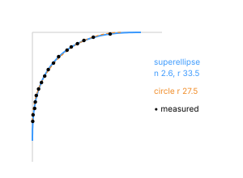

# App icon geometry

Where Silica draws app icons and at what size, plus the icon mask shape and the drop shadow.
Measured on macOS 27 at 1× (1 pt = 1 px). Only sizes, positions and shapes are taken from the
reference; Silica's icons are its own (silica-icons). "Visible" is the drawn icon on screen,
including ±1 pt of antialiasing. Reference: the icons notes and IC-01.

## Sizes by context

| Context | Visible (pt) | Cell (pt) | Pitch (pt) |
|---|---|---|---|
| Dock at rest (size slider at 0.384) | ~47–48 | 63 × 79 | 63 |
| Dock, under the pointer, small magnification | ~52 | 68 | — |
| Dock, under the pointer, full magnification | ~101–104 | 132 | — |
| Dock, during the launch bounce | 45–46 (no squash) | — | — |
| App switcher | ~104 | — | 134 |
| Launcher grid | 61 | 77 × 77 | 112.5 × 102 (117 between recents and the rest) |
| Folder stack grid | ~96 nominal | 128 | 128 |
| Faro result rows | 38–39 | 47 | row 57 |
| Faro first-run suggestions | 32 | 40 | — |
| Notification banner | 32 | — | — |
| Notification Center (stacked) | 26 | — | — |
| Stage view, under a thumbnail | ~32 | — | — |
| Recent items submenu | 14 | — | item 24 |

Recurring sizes: ~32 (notifications, stage view, suggestions), ~48 (Dock), ~60 (Launcher),
~104 (switcher). The drawn icon fills **80.5 %** of its nominal size (512 → 412, 128 → 104,
64 → 52, 32 → 26).

## Mask shape (ref: icons › mask)

Corner of a 104 pt icon: inset of the edge (where coverage crosses 50 %) at each distance from the
top edge:

| from top (pt) | 0.5 | 1.5 | 2.5 | 3.5 | 4.5 | 5.5 | 7.5 | 9.5 | 11.5 | 13.5 | 15.5 | 17.5 | 19.5 | 21.5 | 23.5 | 25.5 | 27.5 |
|---|---|---|---|---|---|---|---|---|---|---|---|---|---|---|---|---|---|
| inset (pt) | 24.0 | 18.8 | 15.9 | 13.9 | 12.0 | 10.7 | 8.1 | 6.5 | 4.9 | 3.8 | 2.8 | 1.9 | 1.2 | 0.9 | 0.7 | 0.2 | 0.1 |

- Best fit: per-corner superellipse `|x/r|^n + |y/r|^n = 1` with **n ≈ 2.6, r ≈ 0.32 × side**
  (33.5 pt on 104). A circle fits much worse (r ≈ 27.5, error ×8).
- The curve starts ~29 pt from the corner on a 104 pt side and blends with continuous curvature.
- Uncertainty: one icon, one corner, ±0.3 pt.

## Drop shadow (ref: IC-01)

A black Gaussian shadow of the icon square, the same in every icon style:

| Size | Opacity | σ (px) | Offset down (px) | σ / side | offset / side |
|---|---|---|---|---|---|
| 512 | 0.25 | 7.5 | 3.1 | 1.8 % | 0.75 % |
| 128 | 0.28 | 2.7 | 1.2 | 2.6 % | 1.2 % |
| 64 | 0.20 | 1.45 | 0.8 | 2.8 % | 1.5 % |
| 32 | 0.35 | 1.2 | 0.55 | 4.7 % | 2.1 % |

(32 and 64 are affected by antialiasing.)

## Edge light (ref: IC-01)

- An inner highlight at the top (and usually the bottom) and a slight darkening on the sides,
  about 1 % of the side wide (~2 % at the top in the glass and tinted styles), down to a single
  pixel at small sizes. It is not a uniform stroke.
- The edge is redrawn at the final size when the Dock magnifies (not scaled), and it does not move
  with the pointer or the bounce.
- In the glass and tinted styles the Dock and the switcher also draw a ~2 px dark outline outside the
  shape, and icons there are see-through (the panel shows through the design); everywhere else
  icons are opaque.

## Not measured

- Dock icons at other slider sizes; icons in file manager icon view and in Settings.
- Mask shape on other icons and at small sizes; 2× rendering.
