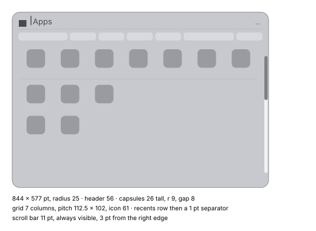

# Launcher

The Launcher is the app grid opened from the Dock. It is Faro in another mode: same panel
material, same header axis, and Esc turns it back into Faro ([faro.md](faro.md)). Measured on
macOS 27 (1 pt = 1 px, 2560 × 1440, neutral gray background). Font sizes are inferred from cap
heights using Inter's proportions (±1 pt). Reference: the launcher notes and PA-60, SH-LP-02…04.

## States

| State | What shows |
|---|---|
| Rest | empty search field with the placeholder, a row of 7 category capsules, the grid (a top row of recent apps, a separator, then all apps alphabetically), scroll bar always visible |
| Category chosen | the category becomes a token in the field; the capsule row goes away; the grid moves up and lists only that category alphabetically (no recents row) |
| Search | only the results, laid out from the first cell; no recents, no separator |
| Search with completion | the rest of the best match's name is shown selected inline, followed by " — Open"; its icon appears at the right of the field; the first result has a selection ring |

The panel stays the same size in every state; unused space below the grid is just empty.

## Panel (ref: launcher › panel)

| Property | Light | Dark |
|---|---|---|
| Size | 844 × 577 pt | same |
| Position | centred horizontally; top edge at 30 % of the screen height | same |
| Corner radius | 25 pt, circular | same |
| Fill on gray | `#c8c9ce` | `#717276` |
| Outer dark line (1 pt) | sides `#444548`, top `#4f5053`, bottom `#393a3c` | ~`#040404` |
| Top luminous row + inner gradient (6–7 pt) | `#e2e3e8` → fill | `#9c9da1` → fill |
| Bottom luminous row | `#dedfe4` | `#96979b` |
| Shadow | offset ~17 pt down, extent ~35 pt (53 below, 18 above); first pixel outside: −39 levels below, −23 at the sides | extent ~40 (58 below, 22 above); −68 below, −40 at the sides |

Material: Faro's thick glass (see [faro.md](faro.md)): blur σ ≈ 8–9 pt with a non-Gaussian kernel,
no sharp component, the same concave transfer curve and colour matrix (saturation ≈ 1.7–1.8).
Edge refraction not determined.

Vertical layout: header 56 pt; 1 pt separator 20 pt in from each side (light `#afb0b5`, dark
`#949599`); capsule zone 47 pt (capsules 10 pt from the separator); grid area below. With a
category chosen the grid starts right after the separator (first cell 12 pt below it).

## Header and search field (ref: launcher › header)

- No field background or border: text and glyphs sit on the panel.
- Left glyph (apps / back): ~25 × 22 pt, 22 pt from the left edge, centred on the header;
  light `#494a4f`, dark `#edeef2`.
- Text cursor: 2 × 31 pt, 61 pt from the panel's left edge; light `#16171c`, dark `#ffffff`.
  It fades in and out rather than blinking: ~135 ms rise, ~500 ms fully on, ~120 ms fall,
  ~280 ms off; period ≈ 1 s.
- Placeholder: ~26 pt regular, light `#494a4f`, dark `#edeef2`. Typed text: same size, light
  `#16171c`, dark `#ffffff`.
- "…" button at the right: three dots ~4 × 3 pt, 7 pt pitch, the last ending 23 pt from the
  edge; same colour as the placeholder. Its menu offers Grid (checked) and List; List narrows the
  panel to 640 pt with a recents row on top and a list (~37 pt icons, ~57 pt row pitch).
- Inline completion: the completed part sits on a neutral gray rounded rectangle 32 pt tall,
  radius ~8 (light `#a2a3a8`, dark `#97989c`), text light `#232429`, dark `#ffffff`.
- App icon at the right of the field during completion: ~27 × 27 pt, 18 pt left of the "…".
- Category token: rounded rectangle 31 pt tall, radius ~10, light `#afb0b5`, dark `#949599`,
  text at field size (light `#0d0e13`, dark `#ffffff`), ~6 pt left padding; typed text continues
  ~8 pt after it.

## Category capsules (ref: launcher › capsules; SH-LP-02)

| Property | Value |
|---|---|
| Height | 26 pt |
| Radius | ~9 pt (a rounded rectangle, not a full capsule) |
| Gap | 8 pt |
| Width | text + 9 pt per side, minimum 85–86 pt (short text centred) |
| Row | starts 20 pt from the left edge, ends 20 pt from the right |
| Fill | light `#d9dadf`, dark `#828387`; no border or shadow |
| Text | ~15 pt regular/medium; light `#5a5b60`, dark `#feffff`; never truncated |
| Hover | no change |
| Pressed | fills with the accent (sRGB `#158eff`), white text |
| Release | the category becomes the token |

When the grid scrolls the capsule row stays; content is clipped sharply below it, and a second
1 pt separator appears just above the clip (same colour as the first).

## Grid (ref: launcher › grid; SH-LP-03)

| Property | Value |
|---|---|
| Columns | 7 |
| Cell | 112 × 92 pt, pitch 112.5 pt; 20 pt left margin |
| Icon | 61 × 61 pt drawn (77 pt with shadow room), centred, 7 pt below the cell top |
| Icon shadow | ~42 levels darker 1 pt below, fading within ~10 pt |
| Row pitch | 102 pt; recents row to the first alphabetical row 117 pt |
| Recents separator | 1 pt, full grid width, 13 pt below the recents cells |
| Label | ~14 pt, 11 pt below the icon, centred, max width 110 pt, truncated at the end with "…"; light `#16171c`, dark `#ffffff` |
| Hover | no change |
| Pressed icon | 4 pt blue ring flush with the icon (Display ~`#2462c6`), icon slightly darker; on release the app opens and the launcher is gone within ~150 ms |
| Keyboard | ↓ selects the first icon, ← → move; the selection is the same 4 pt blue ring (69 × 69 box); the field shows "<name> — Open" selected and the app icon on the right |
| First search result (completion) | gray ring, 4 pt, outer radius 17 pt, 69 × 69; light `#838488`→`#747579`, dark `#abacb0`→`#98999d` |

## Scroll bar (ref: launcher › scrollbar)

- Always visible: opaque track 11 pt wide, ends rounded with radius 5.5, 3 pt from the right edge;
  starts 40 pt below the top of the scroll area and ends 49 pt above the panel bottom.
- Track: light `#f2f2f2`, dark `#141414`. Thumb: light `#808080`, dark `#7c7c7c`; length
  proportional to visible / total content.
- With short content (category, search) the track stays and there is no thumb.
- No hover, pressed or widening state.

## Keyboard and tokens (ref: PA-60)

- Tab with an app selected (or a completion) turns it into a token (icon + name); the panel
  shrinks to 640 pt and shows the app's actions (empty: "No results"). ⌫ or Esc removes the token
  and returns to the grid (the grid fades back).
- ⌫ in an empty field with a category token removes it and shrinks the panel to a 640 × 57 pt bar
  with the glyph, placeholder and "…". A click outside closes.
- → during completion does nothing; Tab accepts the completion as a token.

## Animations (ref: launcher › animations; PA-60)

| Event | Behaviour |
|---|---|
| Open | first frame already shows the whole panel ~6–8 % larger and centred; it shrinks to size in ~120 ms with a small (~3 pt) bounce settling within ~500 ms; opacity reaches 1 in ~55–65 ms |
| Category change | old grid, capsules and scroll bar disappear in one frame, the token appears; ~70–80 ms empty; the new grid fades in over ~150–160 ms (ease-out: 50 % at ~45 ms, 90 % at ~115 ms); no movement; ~230 ms in total |
| Search results | replaced in a single frame ~80 ms after the first key (~50 ms after the last), no fade |
| Esc at rest | becomes the 640 pt Faro bar: content vanishes first (~210 ms after the key), then the panel shrinks towards the bar in ~220 ms (13 % at 15 ms, 58 % at 68 ms, 91 % at 135 ms), with a ~4–5 pt overshoot settling in ~150 ms; side edges converge symmetrically |
| Second Esc | closes |

## Not measured

- Real scrolling (inertia, bounce).
- Closing with a click outside.
- Dragging icons (reorder, folders); dark variants of the pressed states.
- Token width as a function of the text; shadow blur parameters; edge refraction.
