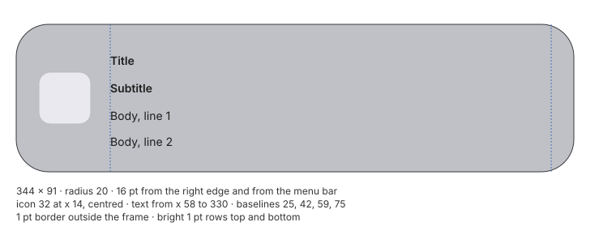

# Notifications

Banners and Notification Center. Measured with test notifications made of a title, a
subtitle and a two-line body, and with a system notification that carries actions. The
background is the grey wallpaper.

## Banner geometry (N-00)

- **Frame:** **344 × 91 pt** for a title, subtitle and two-line body.
  - It sits **16 pt** from the screen's right edge and **16 pt** below the menu bar.
  - The same card appears in Notification Center, at the same place and size.
- **Border:** a 1 pt dark border is drawn **just outside** the frame on all sides.
- **Corner radius:** **20 pt** on the outer border (±1).
- **App icon:** 32 × 32, 14 pt from the left edge, centred vertically.
  - Corner radius about 7.
  - A thin darker outline, `#babbbf` in light.
- **Text column:** starts **58 pt** from the left edge (14 + 32 + 12) and ends 14 pt from the
  right edge.
- **Padding:** 12 pt from the top edge to the title's frame, and 13 pt from the body to the
  bottom edge.
- **No time label** on the banner.

### Banner text

| Line | Baseline below the frame top | Size | Weight |
|---|---|---|---|
| Title | 25 | about 14 pt (capitals 10) | semibold to bold |
| Subtitle | 42 | about 14 pt | as the title |
| Body, line 1 | 59 | about 14 pt | regular |
| Body, line 2 | 75 | — | — |

- **Line pitch:** about 16.5 pt.
- **Colour:** all three texts use the **same colour**: about `#1d1d1e` in light and `#eaeaeb`
  in dark.

## Banner material

| | Light | Dark |
|---|---|---|
| Fill over `#7a7b80` | `#bfc0c5` → `#c2c3c8` from top to bottom | `#727479` → `#77787d` |
| Outer border, sides | `#393a3d` | `#37383c` |
| Outer border, top / bottom | `#5e6064` / `#636367` | almost invisible at the top / `#747579` |
| Inner bright row, top, then its fade | `#d6d7dd`, `#c3c4ca`, `#c1c2c7`, `#bfc1c5` | `#93949a`, `#7a7b81`, `#77787e` |
| Inner bright row, bottom | `#d8d9df` (row above `#c6c7cd`) | `#95979d` (row above `#7e7f84`) |

- **Bright rows:** 1 pt at the top and bottom, not at the sides, fading over 3–4 pt.
- **Light versus dark:** light is much brighter than the grey behind it, by about +68
  levels. Dark is almost the same as the grey, about −5.
- **Shadow:** very faint and shifted downwards.
  - About −4 levels (light) or −6 (dark) just below the banner, fading over about 15 pt.
  - About −2 / −3 at the sides, gone within about 9 pt.
  - None above.

### Blur and colour

- **Blur:** σ ≈ **10–11 pt**, w ≈ 0.02–0.04, so it is almost a pure Gaussian. It is two to
  four times blurrier than the Dock and the Control Center modules.
- **Very little contrast gets through:** black and white stripes become 194–236 in light and
  71–127 in dark.
- **Gain and offset change down the card:** the card has a slight vertical gradient.

Colour fitted on a notification in Notification Center:

| | M (rows: output R, G, B) | b | Constrained |
|---|---|---|---|
| Light | `[[0.632, -0.150, -0.096], [-0.052, 0.469, -0.023], [-0.132, -0.202, 0.731]]` | `[141.4, 139.4, 139.2]` | s 1.67, g 0.400, c 139.7 |
| Dark | `[[0.757, -0.256, -0.091], [-0.111, 0.512, 0.012], [-0.148, -0.297, 0.857]]` | `[42.5, 43.9, 42.3]` | s 2.09, g 0.416, c 42.0 |

- **Top card of a stack:** it is lighter, with more offset and less gain. In light: s 2.34,
  g 0.273, c 172.4. In dark: s 2.50, g 0.372, c 55.7.
- **Light and dark differ:** the offset is about 140 in light and 43 in dark, while the gain
  stays about 0.4.

### Lens

- **Near the top and bottom edges** the content behind is magnified sideways, by up to about
  4 % within 5–6 pt of the edge.
  - The shift grows with the distance from the banner's centre.
  - At mid-height there is no shift.
- **Side edges:** no shift beyond ±1 pt.

## Banner behaviour (N-01, N-02)

| Phase | Duration | What happens |
|---|---|---|
| Entering | about **400 ms** | slides in from the right edge, decelerating; it also fades in (about 210 ms) and **comes into focus from a blur** (about 215 ms); no overshoot |
| Staying | about **5 s** from its appearance | still |
| Leaving | about **180 ms** | slides out to the right while fading out and blurring; it barely slows at the end |

Left edge of the banner during the entrance, one frame (about 13 ms) apart, as distance from
the final position in pt:

`172, 147, 121, 99, 81, 66, 53, 43, 34, 27, 21, 17, 14, 11, 9, 7, 5, 4, 3, 2, 1, 0`

Each frame closes about 18 % of the remaining distance, a time constant of about 65 ms.

- **Several banners from the same app:** the new banner **replaces** the old one in the same
  place.
  - The old one leaves to the right while the new one enters, overlapping for about 100 ms.
  - Banners never stack on screen.
- **Pointer over a banner:**
  - The banner **does not time out**. It leaves about 1.1 s after the pointer moves away.
  - A **close button** of about 21 pt appears on its top-left corner: a light disc with a
    dark × and a dark outline, centred 4 pt right of and 6 pt below the corner.
  - A **"Show" button** appears on the right: a 65 × 21 capsule, 9 pt from the right edge,
    centred vertically, slightly darker than the banner. The body text shortens to make
    room.
  - Both appear in one frame. The banner keeps its size and place.
- **Click:** opens the app that sent the notification.
- **Dragging to the right:**
  - The banner follows the pointer almost 1:1.
  - On release it **always leaves**, for any drag from 15 pt up, even after a pause.
  - Dragging never opens the app.
- **Focus on:** notifications arrive silently, and **no banner** appears.

## Notification Center (N-00, N-03)

### Layout

- **Column:** 344 pt wide, 16 pt from the right edge.
- **Elements, from top to bottom:**

  | Element | y | Height | Gap above |
  |---|---|---|---|
  | menu bar | 0 | 30 | — |
  | first notification | 46 | 91 | 16 |
  | header ("Notification Center") | 152.5 | 21 | 15.5 |
  | next notification | 181 | depends on content | 7.5 |
  | Choose Widgets button | — | 24 | 16 |

- **Header:**
  - **Text:** about 18–19 pt, bold, aligned with the column's left edge, white with some
    transparency.
  - **Clear All button:** a **20 pt circle**, aligned with the column's right edge and
    centred on the header.
    - Its fill grades from `#c4c5c8` to `#b4b5b9`.
    - Its sides are `#2c2d30`, its top and bottom `#57575a`.
    - The × glyph is `#5a5b5c`.
- **Choose Widgets:**
  - A **91 × 24** pill, with text of about 11 pt.
  - Next to it, 8 pt apart, a **24 pt** circle that opens a menu.
  - The pair is centred on the column.
  - Fill `#b4b5b9`–`#b7b8bb`, bright top and bottom rows (`#cdced3` / `#d1d2d7`), sides
    `#37383a`.

### A notification with actions

- **Card:** 344 pt wide.
  - The upper part holds the icon, title, time and body, on `#bebfc3` (light).
  - Below a 1 pt divider (`#949498`), the **actions part** is about 20 levels darker in light
    (`#a8a8ac`–`#aaabaf`) and about 20 lighter in dark.
- **Time:** about 11 pt, a secondary colour, right-aligned 14 pt from the edge. Its baseline
  sits 1 pt above the title's.
- **Body:** about 14 pt, with lines 16 pt apart.
- **Question text** above the buttons: about 11 pt, secondary colour, with lines 14 pt apart.
- **Buttons:**
  - Two side by side, each **156 × 22**, with 8 pt between them.
  - They are inset 12 pt from the card's sides and bottom, and sit 13 pt below the question.
  - Capsule shape, about 11 pt radius.
  - Flat fill, 20 levels darker than the section, with no border.
  - Text about 14 pt.
  - A button can open a menu.

### Scrim

- **What it is:** with Notification Center open, a **single wide, soft halo** darkens the
  screen around the whole column. It is not drawn per card.
- **Strength:**
  - Between cards the grey drops to about 0.74–0.80 of its value.
  - On the left it starts about 70 pt before the column.
  - On the right it is about −16 to −23 levels.
  - Below the last element it fades over about 60 pt.
- **Cards see part of it:** in dark a card reads `#66676c`, instead of `#75767b` for a lone
  banner.

### Stacks

- **Grouping:** notifications from the same app gather into a stack. Notifications sent long
  apart can form separate stacks.
- **Collapsed stack:** **two cards peek out** under the top card, each strip 7 pt tall at an
  8 pt pitch.
  - The strips are inset by about 19 and 29 pt per side (±3).
  - Each strip has a lighter row along its bottom.
- **Expanding a stack** (click), about 200 ms:
  - The notifications lay out in a column at a **64 pt pitch**: 58 pt cards with 6 pt gaps.
  - A header shows the app's name (about 19 pt) on the left.
  - On the right are a **"Show less"** capsule (102 × 20) and a × circle (20 × 20).
- **Hovering the × circle:** it turns into a **"Clear"** capsule (65 × 20). At the same time
  "Show less" shrinks into a 20 pt circle with an up arrow, so the two shapes swap widths.
- **Clearing:**
  - Clicking Clear removes the group, and the rest moves up in about 150–200 ms.
  - The Clear All button of the header removes **all** notifications.
- **Empty state:**
  - The text "No recent notifications", white semibold, centred on the column.
  - The Choose Widgets pill 33 pt below it.
  - The scrim stays.

### Opening and closing

| Action | Result |
|---|---|
| First click on the clock | the clock's capsule appears at once; the panel only about 600 ms later (*cold start*) |
| Later clicks | panel about 80 ms after the click |
| Opening | the whole column slides in from the right: most of the way in about 35 ms, then a long tail of about 200 ms; the scrim appears with it; no overshoot |
| Closing (Esc, the clock again, or a click outside) | about **300 ms**: a small shift first, then a fast exit to the right and a short tail |

## Not measured yet

- Banners with more lines or with actions.
- The pressed states of the banner's buttons.
- Banners from different apps at the same time.
- Alert-style notifications, which stay until dismissed.
- Inline replies.
- Scrolling a long list.
- Dragging a notification out of Notification Center.
- Widgets.
- The exact radii of the small capsules and circles.
