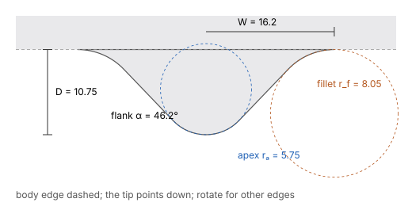

# Tips of menus and popovers (TIP-01)

The small pointer that joins a menu or popover to the thing it belongs to: the Dock's icon
menus, the Dock's hover label, and popovers on any of the four edges.

Status menus and the Control Center have **no tip**. They hang from the menu bar as plain
panels.

## Shape

A tip is **not a triangle**. Its outline has five parts:

- a wide **concave fillet** where it leaves the body edge, of radius r_f;
- a short **straight flank**;
- a **round apex** of radius rₐ;
- the second straight flank;
- the second fillet.

The model:

- Two straight flanks meet the body edge at angle α, which would give a sharp half-base Hb
  without rounding.
- A circle of radius rₐ is tangent to both flanks at the apex.
- On each side, a circle of radius r_f is tangent to the body edge and to the flank.
- D is the depth from the body edge to the apex.
- W is the half-width where the outline leaves the body edge.

This model fits the measured outline within about 0.2 pt, the limit of the measurement at
1×.

| Case | D | W | α | rₐ | r_f | Hb | Width at D/2 |
|---|---|---|---|---|---|---|---|
| Popover, tip on the top or bottom edge | 10.75 | 16.2 | 46.2° | 5.75 | 8.05 | 12.76 | 15.2 |
| Popover, tip up (popover below its anchor) | 10.86 | 16.1 | 46.2° | 5.41 | 7.97 | 12.73 | 15.0 |
| Popover 420 × 220 (larger body) | 10.84 | 16.0 | 46.1° | 5.48 | 7.55 | 12.77 | 14.9 |
| Popover, tip on a side edge | 11.71–11.77 | 19.3–19.6 | 46.0–46.2° | 5.71–5.75 | 13.3–13.8 | 13.7 | 16.2–16.3 |
| Dock icon menu | 10.19 | 15.3 | 50.8° | 5.30 | 9.41 | 10.82 | 13.2 |
| Dock hover label | 6.5 | 9.4 | 39° | 0.9 | 3.0 | 8.3 | — |

- **Alternative fits:**
  - Two cubic Béziers per half fit the outline just as well (0.15–0.29 pt).
  - A single cubic per half, with flat tangents at both ends, misses by 0.35–0.41 pt and
    makes the apex visibly too sharp.
- **Symmetry:** the two halves agree within 0.2 pt.
  - On the Dock menu the tip sits 27 pt from the menu's left edge. Its left fillet runs
    into the body's corner, whose radius is about 12.
- **Size:** the tip has a **fixed size in pt**. A bigger popover gets the same tip.
- **Side tips:** they are about 1 pt deeper and have longer fillets. The flank angle and the
  apex radius are the same as on the top and bottom edges.
- **Dark appearance:** the geometry is the same within about 0.3 pt.
- **Rounding of the model:** the arcs are the simplest shape that fits within the error. A
  superellipse-like blend would fit equally well.

Row widths of the Dock menu tip, from the body edge towards the apex, in 1 pt rows:

`24.2, 19.4, 17.0, 15.3, 13.7, 12.1, 10.4, 8.8, 6.9, 2.7`

Row widths of the Dock label tip:

`20.4, 13.4, 10.1, 7.8, 5.3, 3.7, 0.5`



## Paths

Origin on the apex. The tip points down (+y) and the body edge is at y = −D. Rotate by 180°
or ±90° for the other edges.

Popover, tip on the top or bottom edge:

```
M-16.193,-10.745 A8.053,8.053 0 0 1 -10.382,-8.267 L-4.147,-1.768
A5.747,5.747 0 0 0 4.147,-1.768 L10.382,-8.267 A8.053,8.053 0 0 1 16.193,-10.745 Z
```

Popover, tip on a side edge:

```
M-19.619,-11.752 A13.830,13.830 0 0 1 -9.633,-7.490 L-4.155,-1.773
A5.755,5.755 0 0 0 4.155,-1.773 L9.633,-7.490 A13.830,13.830 0 0 1 19.619,-11.752 Z
```

Dock icon menu:

```
M-15.289,-10.187 A9.414,9.414 0 0 1 -7.992,-6.720 L-4.105,-1.950
A5.295,5.295 0 0 0 4.105,-1.950 L7.992,-6.720 A9.414,9.414 0 0 1 15.289,-10.187 Z
```

Dock hover label:

```
M-9.361,-6.516 A3,3 0 0 1 -7.461,-5.838 L-0.583,-0.208
A0.92,0.92 0 0 0 0.583,-0.208 L7.461,-5.838 A3,3 0 0 1 9.361,-6.516 Z
```

## Rim and shadow

Measured along the column through the apex and compared with a straight part of the body
edge, on a popover with its tip pointing down, in light appearance.

- **Inner highlight:** the last row inside the outline is brighter than the fill, and the
  fill brightens over the last 5 pt. Over black the straight edge reads `#aaabaa` against a
  fill of `#858585`. The highlight follows the tip but **thins towards the apex**, where it
  reads `#969696`.
- **Outer dark line:** a 1 pt darker line just outside the outline follows the whole tip.
  - Over white it reads `#9b9b9b` along the straight edge, and `#cacaca` / `#c1c1c1` spread
    over 2 pt at the apex.
  - In dark appearance it is much stronger: `#1f1f1f` over white.
- **Shadow:**
  - Below the straight edge, over white, it fades from `#d6d6d7` (1 pt out) to `#ededed`
    (8 pt out).
  - Around the apex it is lighter, `#e5e5e5` → `#f4f4f4` over 7 pt.
  - The Dock menu has the same structure: a dark line `#b1b1b1` at the apex over white, and
    a shadow reaching `#f3f3f3` in 7 pt.

## Limits

- At 1×, details below about 0.2 pt cannot be resolved.
- The Dock label tip sits over the Dock's own glass, and was fitted from 7 row widths only
  (±0.5 pt).
