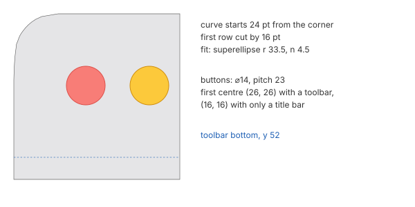

# Windows

The window frame drawn by Ossido and the parts every app window shares: corners, shadow,
border, the sidebar, the toolbar and its capsules, the window buttons, and the open, close,
minimise and full-screen animations. Measured on a 900 × 600 file manager window on the grey
wallpaper (W-00), and on a document window (W-TL).

## Corners

- **Same in both appearances:** all four corners match exactly in light and dark.
- **Not a circular arc.** The curve starts **24 pt** from the corner along each side, and the
  first row is cut by 16 pt. The curvature is continuous, superellipse-like.
  - The best simple fit is |x/r|ⁿ + |y/r|ⁿ = 1 with **r = 33.5, n = 4.5**. r and n trade off
    against each other; r = 30, n = 4 is nearly as good.
  - An equivalent single radius of about 17.6 pt gives the same area. It is only an order of
    magnitude: do not draw with it.
- **The mask, row by row:** pixels missing per row from the corner's edge, row 0 being the
  top edge. With this table the mask can be rebuilt exactly.

  | Row | 0 | 1 | 2 | 3 | 4 | 5 | 6 | 7 | 8 | 9 | 10 | 11 |
  |---|---|---|---|---|---|---|---|---|---|---|---|---|
  | Missing (pt) | 16.00 | 10.05 | 7.90 | 6.42 | 5.26 | 4.28 | 3.47 | 2.73 | 2.14 | 1.73 | 1.37 | 0.95 |

  | Row | 12 | 13 | 14 | 15 | 16 | 17 | 18 | 19 | 20 | 21 | 22 | 23 | 24 |
  |---|---|---|---|---|---|---|---|---|---|---|---|---|---|
  | Missing (pt) | 0.85 | 0.72 | 0.59 | 0.47 | 0.37 | 0.30 | 0.23 | 0.18 | 0.14 | 0.10 | 0.06 | 0.03 | 0 |

## Shadow

The shadow is pure black, `#000000`, with varying alpha.

| | Active | Inactive |
|---|---|---|
| Extent at the sides | 56 pt | 23 pt |
| Extent above | 38 pt | 16 pt |
| Extent below | 74 pt | 30 pt |
| Downward shift | **18 pt** | **7 pt** |
| Blur σ (side profile) | 19.5 pt light, 20 pt dark | 8.5 pt light, 9 pt dark |
| Peak alpha (fit amplitude A, of 255) | 100 light, 190 dark | 72 light, 194 dark |

- **Profile:** the side profile is the edge of a Gaussian, alpha(d) = A · ½ · erfc((d − s) /
  (√2 σ)), with s between −4 and +0.5. It has no horizontal shift.
- **Above and below:** the same profile, shifted down by the amount in the table.

Alpha (0–255) at distance d from the window's outer edge, along the side:

| d (pt) | 2 | 4 | 6 | 8 | 10 | 12 | 14 | 16 | 18 | 20 | 24 | 28 | 32 | 40 | 48 |
|---|---|---|---|---|---|---|---|---|---|---|---|---|---|---|---|
| Active, light | 48 | 44 | 40 | 36 | 32 | 30 | 26 | 22 | 20 | 16 | 12 | 7 | 6 | 2 | 0 |
| Active, dark | 88 | 76 | 70 | 64 | 57 | 51 | 44 | 39 | 34 | 29 | 20 | 14 | 10 | 4 | 1 |
| Inactive, light | 24 | 18 | 14 | 10 | 6 | 4 | 2 | 2 | 1 | 0 | – | – | – | – | – |
| Inactive, dark | 54 | 38 | 28 | 20 | 14 | 8 | 4 | 3 | 2 | 0 | – | – | – | – | – |

- **Contact ring:** the pixel just outside the body is darker than the profile, and shows as
  a **1 pt dark line** around the window.

  | | Active | Inactive |
  |---|---|---|
  | Light | 0.32 | 0.23 |
  | Dark | 0.95, an almost opaque black border | 0.87 |
- **Dark against light:** the dark shadow is about twice as strong. The inactive shadow has
  about 0.43× the blur and 0.39× the shift of the active one.

## Border and background

- **Inner border:**
  - **Dark:** a 1 pt **lighter inner border**, `#3d3d3d` when active, `#3a3a3b`–`#404041`
    when inactive, on a `#272728` content background.
  - **Light:** none.
- **Content background:** light `#ffffff`, dark `#272728`.
- **Toolbar, active window:** the same colour as the content, with no separator under it.
- **Toolbar, inactive window:**
  - In dark it gets its own background, `#2e2e2e`–`#2f2f30`.
  - A **1 pt line at y 52** separates it from the content: light `#e5e5e5`, dark `#363636`.
  - The line is also there in full screen.
- **Opacity:** the window is **opaque**. Wallpaper never shows through the content, sidebar
  or toolbar.

## Sidebar

- **Placement:** **192 pt** wide, running from the window's top to its bottom, attached to
  the window's edges with no margin or radius of its own.
  - It sits under the window buttons, beside the toolbar.
  - Between sidebar and content there is no line, only a change of tone.

| | Light | Dark |
|---|---|---|
| Active | `#e5e5e7`, slightly darker within about 50 pt of the top and bottom (223) | `#303133`, slightly lighter at the edges |
| Inactive | `#f2f2f2`, flat | `#29292a`, flat |
| Full screen, active | `#ededed`, flat | not measured |

- **Active sidebar:** it is a material, slightly affected by what lies behind the window.
- **Inactive sidebar:** it is flat.
- **Rows:**
  - 32 pt pitch.
  - From a section heading to its first row: 24 pt. From the last row to the next heading:
    40 pt.
- **Row icons:** about 16–19 × 14–17, centred at x 29 and vertically on the row.
  - Tag dots are **13 × 13**, centred at x 29.
- **Row text:**
  - It starts at **x 47**, about 14 pt, regular weight.
  - Colour: light `#000000`, dark `#ffffff`. In an inactive window light `#727272`, dark
    `#949495`.
- **Section headings:**
  - Text at x 17, about 11–12 pt, semibold.
  - Active: `#808182` light, `#7c7d7e` dark. Inactive: `#a6a6a6` / `#5c5c5d`.
- **Icon colours in an active window:**
  - places use the accent, `#0075f2` light or `#009eff` dark;
  - devices and the Trash are grey, `#7c7c82` light or `#b6b7bd` dark;
  - tag dots keep their colours.

  In an inactive window every icon and dot turns grey.
- **Selected row:** a rounded rectangle of radius about 8, as tall as the row, from x 10 to
  about x 171. Its text is semibold.

  | | Light | Dark |
  |---|---|---|
  | Active window: fill / text | `#d4d5d5` / `#000000` | `#474748` / `#ffffff` |
  | Inactive window: fill / text | `#e7e7e7` / `#676767` | `#373738` / `#9b9b9c` |

  Hovering a row draws nothing.
- **Hiding and showing** the sidebar: it slides to the left in about **240 ms** along an
  S-curve.
- **Scroller:** a 5 pt bar with a 3 pt strip beside it.
  - Bar: `#a5a6a7` light, `#5c5d5f` dark.
  - Strip: about 8 levels lighter than the sidebar in light, about 7 darker in dark.

## Toolbar

The toolbar is **52 pt** tall, starting at the top of the window, right of the sidebar. In an
active window it has no background of its own.

### Capsules

Groups of buttons sit in glass capsules.

| Group | Width | Height |
|---|---|---|
| Back and forward | 75 | 38 |
| View modes | 162 | 38 |
| Group by | 48 | 38 |
| Share, tag, actions | 113 | 38 |
| Search | 38 (a circle) | 38 |

- **Shape and spacing:** **7 pt** above and below each capsule, radius **19** (a full
  capsule), and **7–8 pt** between capsules.
- **Outline:** 1 pt, stronger at the sides than at the top and bottom.

  | | Light | Dark |
  |---|---|---|
  | Sides | `#c1c1c1` | `#0f0f0f` |
  | Top | `#eaeaea` | `#767676` |
  | Bottom | `#e7e7e7` | `#686868` |
- **Fill:**
  - Light: `#f7f7f7`–`#fcfcfc`, slightly darker towards the ends.
  - Dark: `#454546`–`#484849`, flat, with a lighter row inside the top edge (`#6b6b6b`).
- **Divider** between back and forward: 1 pt, 21 pt tall, centred. `#c7c7c7` light,
  `#7a7a7a` dark.
- **Selected button in a group:** a **34 × 28** pill, 5 pt inside the capsule, radius 14.
  `#e2e2e2` light, `#595959` dark.
- **Icons:** about 15–20 pt, with a stroke of about 1.5 pt.
  - Colour: black in light, `#e9e9e9` in dark.
  - Disabled icons: `#ababab` in light, darker in dark.
- **Title:**
  - About 15 pt, semibold, centred vertically, about 4 pt below the bar's centre line.
  - Colour: active `#4d4d4d` light, `#e9e9e9` dark; inactive `#bebebe` / `#646464`.
- **Inactive window:** icons and title dim. The capsules keep their outline.

## Window buttons

- **Size and spacing:** **14 pt** discs, plus a 1 pt antialiased halo, with a **23 pt**
  pitch (9 pt between discs).
- **Position:**
  - With a toolbar, the first centre is **26 pt** from the left edge, at the bar's vertical
    centre (y 26).
  - With only a title bar, the centres sit **16 pt** from the left and top edges.

At rest in an active window. Each disc has a vertical gradient, more saturated at the top:

| | Light: centre / top / bottom / side outline | Dark: centre / top / bottom / side outline |
|---|---|---|
| Close | `#f87d77` / `#fe6e66` / `#f58b83` / `#dd4d47` | `#f26056` / `#f8635a` / `#ee6660` / `#ee5549` |
| Minimise | `#fcc93b` / `#fcb82e` / `#fed344` / `#d08d0b` | `#fdc002` / `#fab500` / `#fdcd29` / `#f8b904` |
| Full screen | `#85d660` / `#62d02e` / `#99d979` / `#519e32` | `#39c101` / `#01bc00` / `#4bc133` / `#09b901` |

- **Edges in dark:** a 1 pt bright outline at the top and bottom of each disc.
  - Close: `#fab1a7` / `#fbada5`.
  - Minimise: `#fbee5a` / `#fbf869`.
  - Full screen: `#96fb78` / `#8bfb76`.
- **Inactive window at rest:** all three discs are the same grey.
  - Light: `#eaebec`–`#f4f4f7`, with an outline `#c3c3c7` at the sides.
  - Dark: `#4d4d4d`–`#555555`, with an outline only at the top (`#999999`) and bottom
    (`#909091`).

### States

- **Hover over the group:** the **symbols appear on all three buttons**, not only the one
  under the pointer. The discs keep their colours.
  - **Close:** an 8 × 8 ×, with 2 pt strokes.
  - **Minimise:** an 8 × 2 dash.
  - **Full screen:** two opposite right triangles in a 6 × 6 box, split by a bright
    diagonal.
  - **With ⌥ held,** the full-screen symbol becomes a **+**, for zoom.

| State | Close: disc / symbol | Minimise: disc / symbol | Full screen: disc / symbol |
|---|---|---|---|
| Light, hover | `#f97c72` / `#a30000` | `#ffcf41` / `#c14400` | `#8dd969` / `#368800` |
| Light, pressed | `#ff9f8e` / `#da0000` | `#fffc5d` / `#ff5a00` | `#8edf60` / `#3b9600` |
| Dark, hover | `#f1564d` / `#8c0000` | `#fdc905` / `#a53a00` | `#36c002` / `#2d7201` |
| Dark, pressed | `#ff7560` / `#bb0000` | `#fffb17` / `#dd4c00` | `#3ac80c` / `#337e00` |

- **Pressed:** only the button under the pointer changes. Its disc lightens, and the symbol
  becomes lighter and more saturated. Dragging off before release cancels the action.
- **Inactive window, pointer over the group:** the discs take their active colours and show
  their symbols, but the window stays inactive.
- **Symbol timing:**
  - On entry they are visible in the first frame and complete within about 70–110 ms.
  - On exit they start fading about 60 ms later and are gone by about 110–130 ms.
- **Disabled buttons:** minimise and full screen on a window that cannot be resized are
  **grey discs** even in an active window, and show no symbol on hover. Close stays red.
- **Long press on the green button:** about 1.4 s; nothing at 0.4 s, and plain hover never
  opens it. It opens a **tiling popover** below the button, with its tip at the button:
  1. a "move and resize" group: four icons for the left, right, top and bottom halves;
  2. a "fill and arrange" group: four icons for fill, and for two, three and four windows;
  3. a separator;
  4. full screen ▸;
  5. a separator;
  6. move to another display.

## Full screen

- **Window chrome:** no window buttons, no menu bar, and no rounded corners.
- **Toolbar:** **52 pt**, with the 1 pt line at y 52.
  - The search capsule grows into a field reaching 21 pt from the screen's right edge.
  - Back, forward and the title start at x 156.
- **Sidebar:** 192 pt, flat `#ededed`.

## Animations

### Opening and closing

- **Opening:**
  - The window appears **already opaque** and **scales from about 0.98 to 1.0** around its
    centre in about **93–100 ms**, decelerating.
  - The shadow darkens at the same time.
  - The whole change settles in about 130 ms.
- **Closing:**
  - The window **fades out** over about **100–120 ms**.
  - Opacity per frame: 0.76, 0.51, 0.22, 0.14, 0.05, 0.02, 0.
  - It shrinks very slightly, ≲ 0.5 %.
  - The window behind becomes active immediately.

### Minimise: genie

- **Shape:** the window **bends into a funnel** towards its new Dock cell. Its content stays
  sharp, with no fade.
- **Dock:** it widens to make room as soon as the effect starts.
- **Duration:** about **390 ms**.
  - The top edge falls fast at first, about 175 pt in the first 80 ms.
  - The tail then takes over 200 ms to settle into the Dock.
  - It ends as a **57 × 21** thumbnail in the cell.
- **Restoring:** the reverse, in about **440–470 ms**, slightly longer. There may be a 3 pt
  overshoot (*provisional*).
- **Scale effect:** see [dock.md](dock.md#minimise-effects-sh-dk-09).

### Full screen

- **Entering:** about **520 ms**.
  - The edges do not move together: the left and top edges move first, then the right edge
    keeps growing to the screen's edge.
  - The growth speeds up, peaks about 100 ms in, then decelerates.
  - While the window grows, the old layout and the full-screen layout **cross-fade**.
  - The new space's background is black, and shows at the right during the expansion.
  - The window buttons disappear.
- **Leaving:** about **453 ms**. The size shrinks steadily, fast at first and slow at the
  end, with no bounce.

  Height of the window during the exit, at 13–27 ms steps, in pt:

  `1300, 1284, 1132, 1058, 999, 906, 869, 837, 783, 761, 741, 709, 694, 681, 659, 650, 642, 628, 623, 617, 609, 606, 605, 601, 600`

## Light and dark at a glance

- **Shadow:** about twice as strong in dark, with the same shape and shift.
- **Border:**
  - Dark has a 1 pt light inner border and an almost opaque black contact ring.
  - Light has only the contact ring, at alpha 0.32.
- **Sidebar:** lighter than the content in dark, darker than the content in light.
- **Capsules:** lighter than the background in dark, darker in light.
- **Window buttons:** more saturated in dark, with a bright outline.

## Not measured yet

- The colour of the shadow at the corners and on short edges.
- The status bar.
- The blur and tint of the sidebar and capsule materials over a busy background.
- Precise animation curves for opening, minimising and restoring.
